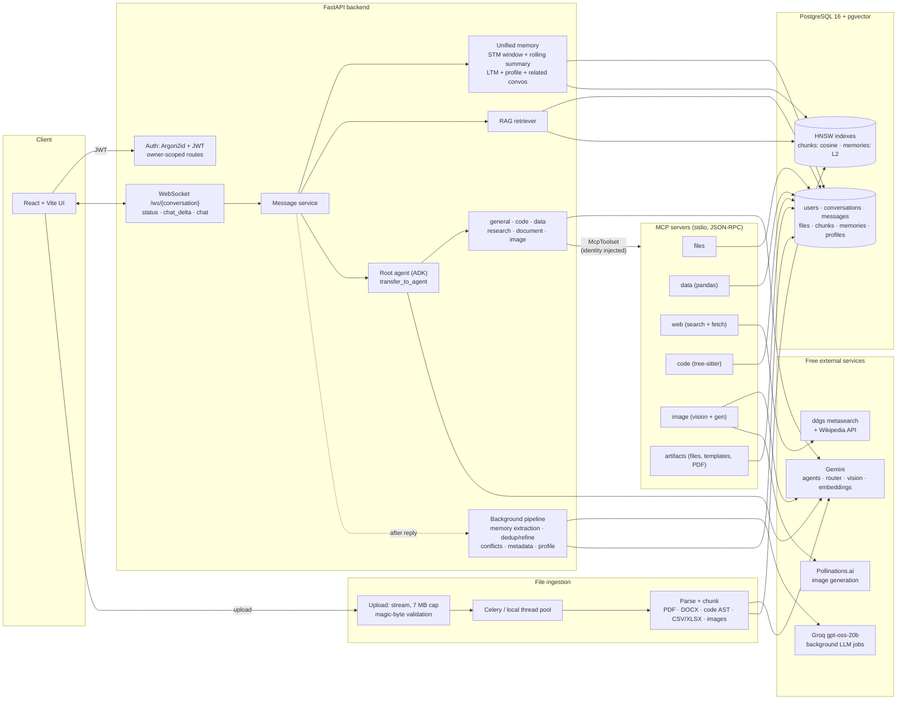
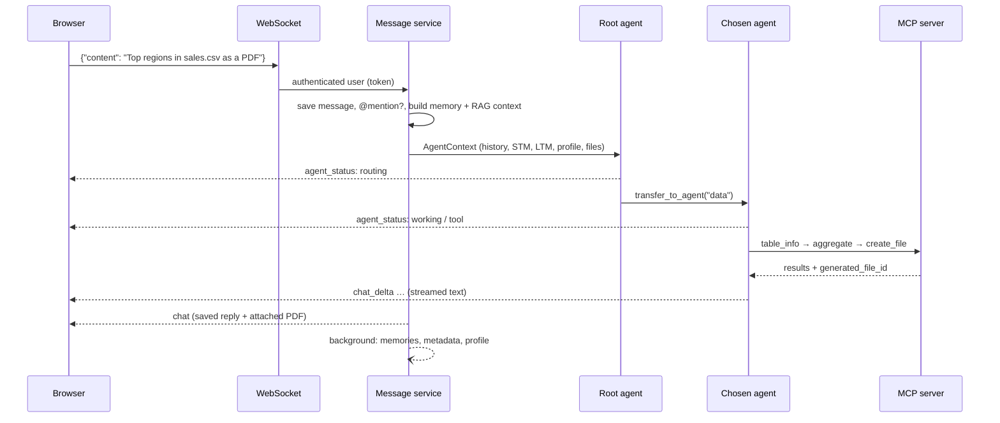

# MCP-based Multi-Agent AI System

A chat assistant where a **root agent** routes every message to one of six specialised **Google ADK** agents. The agents use real tools served by **MCP servers**, remember users across conversations with a **short- and long-term memory** system, and can read uploaded files and generate new ones. Everything runs on **free tiers and open-source software**, with no locally hosted models.

> Learning notes for every change live in [`docs/learning/`](docs/learning/README.md).

---

## Architecture



### Life of a message


### Key design decisions
| Area | Decision | Why |
|---|---|---|
| Agents | ADK root with `sub_agents`; per-request agent objects | Native delegation; no shared mutable state between users |
| History | Our DB is the only source (ADK sessions are throwaway) | Survives restarts; shared when agents switch; token-bounded |
| Memory context | Always retrieve, filter by calibrated distance | Saves an LLM call per turn; deterministic and testable |
| Tools | MCP servers; one process per server, per-agent filtered views | Standard protocol; least privilege |
| Tool security | Identity args overwritten server-side; SSRF guard; no code execution | Prompt injection can't cross users or reach internal services |
| Embeddings | Gemini `gemini-embedding-001`, 768-d, normalised | Spec requirement; no local model; rate-limited client |
| Auth | Argon2id + JWT; owner-scoped queries; 404 for not-owned | Identity never trusted from the client |
| Models | Gemini for chat-facing work, Groq for background jobs | Spreads per-model free-tier quotas; automatic fallbacks |

---

## Requirements coverage

| Requirement | Where |
|---|---|
| PostgreSQL + vector DB | `models/`, pgvector HNSW (`migrations/`) |
| WebSocket real-time + streaming | `api/ws.py` (`agent_status`, `chat_delta`, `chat`) |
| Per-user chat storage, auth | `api/deps.py`, `api/auth.py`, `core/security.py` |
| Multi-file upload, validation, 7 MB limit | `api/file.py`, `crud/file.py`, `file_validation.py` |
| Async processing queue | `file_task_dispatcher.py` (Celery or local pool), `file_ingestion.py` |
| PDF / DOCX / images (vision) / code / CSV / XLSX parsing + chunking | `services/file_processing/`, `services/vision/` |
| Gemini embeddings + vector store + retrieval | `services/embeddings/`, `services/rag/retriever.py` |
| STM: buffer, token counting, summarisation, rolling window | `services/memory/memory_services.py`, `services/tokenization/` |
| LTM: semantic search, ranking, update/delete, profile | `services/memory/ltm_service.py`, `api/memory.py`, `services/user_profile/` |
| Unified STM+LTM, auto-promotion, metadata | `unified_memory_service.py`, `background_memory_pipeline.py` |
| Export / import | `services/conversation/transfer_service.py` |
| Context-aware file generation, templates, preview, MIME, naming | `mcp_servers/artifacts_server.py`, `file_generation/`, `api/file_generation.py` |
| ADK agents, registry, root routing, state, 6 agent types | `agent_layer/` |
| @mention, switching, status indicators | `core/mentions.py`, `root_agent.py`, WebSocket events |
| MCP client + per-agent tools + chaining | `agent_layer/tools/mcp_registry.py`, `mcp_servers/` |

---

## Running locally

**Prerequisites:** Docker, Python 3.12, [uv](https://docs.astral.sh/uv/), Node 20+. You also need free API keys from [Groq](https://console.groq.com/keys) and [Google AI Studio](https://aistudio.google.com/apikey).

```bash
# 1. Configuration: ONE file for everything (backend + docker-compose)
cp backend/.env.example backend/.env   # set POSTGRES_PASSWORD, API keys, JWT_SECRET

# 2. Database + Redis (reads POSTGRES_* from backend/.env)
docker compose up -d            # Postgres+pgvector on :5433, Redis on :6379

# 3. Backend
cd backend
uv venv --python 3.12 .venv
uv pip install --python .venv/bin/python -r requirements-dev.txt
.venv/bin/alembic upgrade head
.venv/bin/uvicorn main:app --reload --port 8000

# 4. Background worker (only when FILE_PROCESSING_BACKEND="celery")
.venv/bin/celery -A app.core.celery_app.celery_app worker --pool=solo --loglevel=info

# 5. Tests
.venv/bin/python -m pytest -q
```
API docs: http://localhost:8000/docs. Click **Authorize** and paste the `access_token` from `/auth/login`. The MCP servers start automatically as child processes of the API.

After changing `EMBEDDING_MODEL` or `EMBEDDING_DIM`, run a migration and then `.venv/bin/python -m scripts.reembed`.

## WebSocket protocol
```
connect  ws://localhost:8000/ws/{conversation_id}?token=<access_token>
send     {"content": "...", "file_ids": [...], "selected_agent": "code"?, "format": "pdf"?}
receive  {"type":"agent_status","data":{"status":"routing|working|tool","agent":..,"tool":..}}
         {"type":"chat_delta","data":{"agent":..,"text":..}}          (streamed pieces)
         {"type":"chat","data":{"user_message":..,"ai_message":..,"active_agent":..,"error":bool}}
```

## Free-tier notes (measured)
| Service | Limit / caveat |
|---|---|
| Gemini embeddings | 100 texts/min (each text in a batch counts); client limiter at 90/min |
| Gemini image generation | free quota is 0, so Pollinations.ai is used instead (watermarked, third-party) |
| ddgs web search | engines rate-limit intermittently, so it tries 6 engines, then the Wikipedia API |
| Gemini / Groq chat models | occasional 503 "high demand", handled by automatic fallback models |

## Project structure
```
backend/
├── main.py                     FastAPI app, routers, shutdown hooks
├── app/
│   ├── api/                    HTTP + WebSocket routes, auth dependencies
│   ├── agent_layer/
│   │   ├── agents/             root (ADK delegation) + 6 specialised agents
│   │   ├── core/               BaseAgent, registry, mentions, agent state
│   │   └── tools/              MCP client registry (per-agent toolsets)
│   ├── mcp_servers/            files, data, web, code, image, artifacts (FastMCP)
│   ├── services/               memory, rag, embeddings, vision, file processing,
│   │                           file generation, llm, conversation, user profile
│   ├── models/ schemas/ crud/  SQLModel tables, Pydantic I/O, DB access
│   ├── core/                   config, security, celery, logging
│   └── prompts/                LLM prompts for background jobs
├── migrations/                 Alembic (baseline + changes)
├── scripts/reembed.py          refill embeddings after a model change
└── tests/                      unit tests (pytest)
frontend/                       React + Vite chat UI
docs/learning/                  one learning note per branch
```
