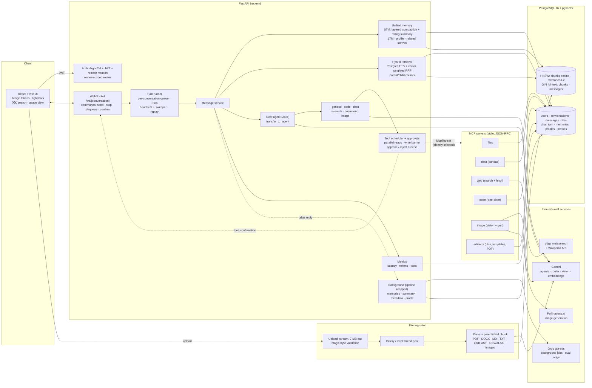

# MCP-based Multi-Agent AI System

A chat assistant where a **root agent** routes every message to one of six specialised **Google ADK** agents. The agents use real tools served by **MCP servers**, remember users across conversations with a **short- and long-term memory** system, and can read uploaded files and generate new ones. Everything runs on **free tiers and open-source software**, with no locally hosted models.

Beyond the core features, the system is built to be **measured and to stay up**:

- per-turn metrics and a usage view;
- an eval suite that gates changes;
- server-owned turns that survive disconnects and crashes;
- human approval for tools with side effects;
- hybrid retrieval;
- bounded context.

> Learning notes for every change live in [`docs/learning/`](docs/learning/README.md), indexed by branch.

---

## Architecture



### Life of a message
```mermaid
sequenceDiagram
    participant U as Browser
    participant W as WebSocket
    participant T as Turn runner
    participant M as Message service
    participant R as Root agent
    participant A as Chosen agent
    participant S as MCP server
    U->>W: {"content": "Top regions in sales.csv as a PDF", "client_id": "…", "confirm_tools": true}
    W->>T: submit (queued behind any running reply)
    T-->>U: turn_queued → turn_started
    T->>M: run turn (own task + own DB session; survives disconnects)
    M->>M: save message, @mention?, compact history, memory + hybrid RAG context
    M->>R: AgentContext (bounded history, summary, LTM, profile, files)
    R-->>U: agent_status: routing
    R->>A: transfer_to_agent("data")
    A->>S: table_info, aggregate (reads run in parallel)
    A-->>U: tool_confirmation: create_file "regions.pdf"
    U->>W: {"type":"confirm","decision":"approve"}
    A->>S: create_file (writes run after the reads, one at a time)
    A-->>U: chat_delta … (streamed, rendered once per frame)
    M-->>U: chat (saved reply + attached PDF) → turn_finished
    M--)M: metrics queued; background: memories, summary, metadata
```

### Key design decisions
| Area | Decision | Why |
|---|---|---|
| Agents | ADK root with `sub_agents`; per-request agent objects | Native delegation; no shared mutable state between users |
| Turns | A server-owned **turn runner**: one lane per conversation, with its own task and DB session | Stop keeps the partial answer; replies survive disconnects; a crashed turn becomes an "interrupted" reply |
| History | Our DB is the only source; **layered, view-only compaction** with a background summary | Bounded tokens on every agent step; no LLM call on the hot path |
| Retrieval | **Hybrid search** (Postgres FTS + vector, weighted RRF) over **parent/child chunks** | Exact codes *and* paraphrases; the agent reads whole passages within a budget |
| Tools | MCP servers with per-agent views; reads in parallel, writes behind a barrier | Real concurrency without ordering bugs |
| Side effects | **Human approval** (approve / reject / revise) for file and image creation; opt-in per client | The user stays in control; older clients never hang |
| Tool security | Identity args overwritten server-side; SSRF guard; no code execution | Prompt injection can't cross users or reach internal services |
| Prompts | Markdown files with includes, proven byte-identical after the move | Reviewable diffs; one copy of shared rules |
| Quality | **Eval suite** (routing, tools, answers, retrieval) with a baseline gate; judge on a different model family | Changes are measured, not assumed |
| Observability | Per-turn metrics (latency, tokens, tools), a **usage view**, PII-redacted | Know where time and tokens go |
| Resilience | Timeouts on every outbound call; quota → 503; keyword search when embeddings are down; capped background jobs that release DB connections during AI calls | A provider outage degrades features instead of taking the app down |
| Auth | Argon2id + JWT; owner-scoped queries; 404 for not-owned; refresh rotation with reuse detection | Identity is never trusted from the client |
| Models | Gemini for chat-facing work, Groq for background jobs, automatic fallbacks | Spreads per-model free-tier quotas |

---

## Requirements coverage

| Requirement | Where |
|---|---|
| PostgreSQL + vector DB | `models/`, pgvector HNSW + GIN full-text (`migrations/`) |
| WebSocket real-time + streaming | `api/ws.py`, `services/turns/` (queue, stop, replay) |
| Per-user chat storage, auth | `api/deps.py`, `api/auth.py`, `core/security.py` |
| Multi-file upload, validation, 7 MB limit | `api/file.py`, `crud/file.py`, `file_validation.py` |
| Async processing queue | `file_task_dispatcher.py` (Celery or local pool), `file_ingestion.py` |
| PDF / DOCX / images (vision) / code / CSV / XLSX parsing + chunking | `services/file_processing/` (incl. `hierarchy.py`), `services/vision/` |
| Gemini embeddings + vector store + retrieval | `services/embeddings/`, `services/rag/retriever.py` (hybrid) |
| STM: buffer, token counting, summarisation, rolling window | `services/memory/compaction.py`, `memory_services.py`, `services/tokenization/` |
| LTM: semantic search, ranking, update/delete, profile | `services/memory/ltm_service.py`, `api/memory.py`, `services/user_profile/` |
| Unified STM+LTM, auto-promotion, metadata | `unified_memory_service.py`, `background_memory_pipeline.py` |
| Export / import | `services/conversation/transfer_service.py` |
| Context-aware file generation, templates, preview, MIME, naming | `mcp_servers/artifacts_server.py`, `file_generation/`, `api/file_generation.py` |
| ADK agents, registry, root routing, state, 6 agent types | `agent_layer/` |
| @mention, switching, status indicators | `core/mentions.py`, `root_agent.py`, WebSocket events |
| MCP client + per-agent tools + chaining | `agent_layer/tools/mcp_registry.py`, `mcp_servers/`, `core/tool_scheduler.py` |

---

## Running locally

**Prerequisites:** Docker, Python 3.12, [uv](https://docs.astral.sh/uv/), Node 20+. You also need free API keys from [Groq](https://console.groq.com/keys) and [Google AI Studio](https://aistudio.google.com/apikey).

```bash
# 1. Configuration: ONE file for everything (backend + docker-compose)
cp backend/.env.example backend/.env   # set POSTGRES_PASSWORD, API keys, JWT_SECRET

# 2. Database + Redis (reads POSTGRES_* from backend/.env)
docker compose up -d            # Postgres+pgvector on :5433, Redis on :6379

# 3. Backend
cd backend
uv venv --python 3.12 .venv
uv pip install --python .venv/bin/python -r requirements-dev.txt
.venv/bin/alembic upgrade head          # run again after every pull that adds a migration
.venv/bin/uvicorn main:app --reload --port 8000

# 4. Background worker (only when FILE_PROCESSING_BACKEND="celery")
.venv/bin/celery -A app.core.celery_app.celery_app worker --pool=solo --loglevel=info

# 5. Backend tests + evals
.venv/bin/python -m pytest -q
.venv/bin/python -m evals.run                    # all suites vs evals/baseline.json (exit 1 = regression, 2 = inconclusive)
.venv/bin/python -m evals.run --suite retrieval  # one suite

# 6. Frontend (new terminal) -> http://localhost:5173, create an account there
cd frontend && npm ci && npm run dev   # frontend/.env is optional (defaults to http://127.0.0.1:8000)

# 7. Browser tests. Start the backend with BACKGROUND_LLM_JOBS_ENABLED=false so test runs
#    don't spend the daily free-tier token budget on background memory jobs.
npx playwright install chromium
npm run test:e2e:fast     # no LLM calls (scripted WebSocket server for streaming/queue/approvals)
npm run test:e2e          # everything, including real-LLM chat tests
npm run test:visual       # screenshots of key screens, both themes, desktop + phone
```
More on the UI, sessions and tests: [`frontend/README.md`](frontend/README.md).
API docs: http://localhost:8000/docs. Click **Authorize** and paste the `access_token` from `/auth/login`. The MCP servers start automatically as child processes of the API.

**Maintenance scripts:**

- After changing `EMBEDDING_MODEL` or `EMBEDDING_DIM`, run a migration and then `.venv/bin/python -m scripts.reembed`.
- To rebuild documents uploaded before parent/child chunking, run `.venv/bin/python -m scripts.rechunk` (try `--dry-run` first).

## WebSocket protocol
```
connect  ws://localhost:8000/ws/{conversation_id}?token=<access_token>

client -> server
  {"content": "...", "file_ids": [...], "selected_agent": "code"?, "format": "pdf"?,
   "client_id": "<uuid>", "confirm_tools": true}        send (queued if a reply is running)
  {"type": "stop"}                                       stop the running reply (partial answer kept)
  {"type": "dequeue", "turn_id": "..."}                  remove a queued message
  {"type": "confirm", "confirmation_id": "...", "decision": "approve|approve_all|reject|revise",
   "feedback": "..."}                                    answer a tool_confirmation

server -> client  (turn events carry turn_id + the client_id of the message)
  turn_state      {current: {status, agent, draft, pending_confirmations}, queued: [...]}   on connect
  turn_queued     {position}            turn_started    {}
  agent_status    {status: routing|working|tool|waiting, agent, tool?, seconds?}
  chat_delta      {agent, text}         streamed reply text
  tool_confirmation {confirmation_id, agent, tool, args, timeout_seconds}
  tool_confirmation_resolved {confirmation_id, decision}
  chat            {user_message, ai_message (status: complete|stopped|interrupted), active_agent, error}
  turn_finished   {status: done|stopped|failed}
  error           {detail, command?, client_id?, confirmation_id?, turn_id?}
                  (a rejected command echoes `command`; a failed turn has turn_id and no command)
```

## Free-tier notes (measured)
| Service | Limit / caveat | How the app copes |
|---|---|---|
| Gemini embeddings | 100 texts/min, plus a **daily** quota | client limiter at 90/min; daily exhaustion fails fast, the API answers **503 + Retry-After**, file search falls back to keyword search, memory search is skipped |
| Groq `gpt-oss-20b` | **200k tokens/day** per model | background jobs can be switched off for test runs; the eval judge falls back to `gpt-oss-120b` (its own budget) |
| Gemini image generation | free quota is 0 | Pollinations.ai instead (watermarked, third-party) |
| ddgs web search | engines rate-limit intermittently | tries 6 engines, then the Wikipedia API |
| Gemini / Groq chat models | occasional 503 "high demand" and per-minute limits | automatic fallback models; short waits shown as a countdown in the UI |

## Project structure
```
backend/
├── main.py                     FastAPI app, routers, error handlers, startup/shutdown
├── app/
│   ├── api/                    HTTP + WebSocket routes (auth, chat, search, memory, metrics…)
│   ├── agent_layer/
│   │   ├── agents/             root (ADK delegation) + 6 specialised agents
│   │   ├── core/               BaseAgent, registry, mentions, confirmation, tool scheduler
│   │   └── tools/              MCP client registry (per-agent toolsets)
│   ├── mcp_servers/            files, data, web, code, image, artifacts (FastMCP)
│   ├── services/               turns (runner), memory (+ compaction), rag (hybrid), metrics,
│   │                           embeddings, vision, file processing, llm, conversation (+ search)…
│   ├── prompts/                prompts as Markdown: agents/, background/, fragments/
│   ├── db/                     engine + pool, slow_io (release connections during AI calls)
│   ├── models/ schemas/ crud/  SQLModel tables, Pydantic I/O, DB access
│   └── core/                   config, security, errors, websocket manager, logging
├── evals/                      datasets, fixtures, graders, harness, baseline.json
├── migrations/                 Alembic
├── scripts/                    reembed.py, rechunk.py
└── tests/                      unit + Postgres-backed tests (pytest)
frontend/                       React + Vite UI (see frontend/README.md)
docs/learning/                  one learning note per branch
```
